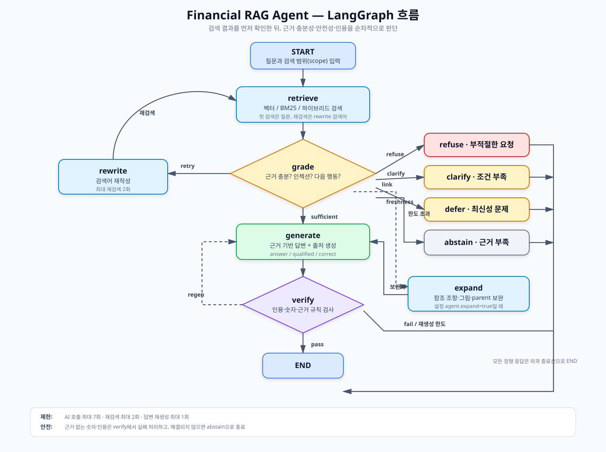

# financial-rag-agent

> [!IMPORTANT]
> **팀원 필독 — `main`에는 직접 푸시할 수 없어요.** (보호 규칙으로 막혀 있어요)
> 반드시 **내 브랜치에서 작업 → 푸시 → `main`으로 PR**을 올려요. PR은 자동으로 승인·머지돼요.
> ```bash
> git switch main && git pull                  # 최신 main 받기
> git switch -c {내 GitHub 아이디}              # 처음 한 번만 (다음부터는 git switch {내 아이디})
> git merge main                               # 작업 시작 전, main 최신 내용 가져오기
> git add . && git commit -m "무엇을 했는지"
> git push -u origin {내 GitHub 아이디}         # → GitHub에서 main 으로 PR 생성 (gh pr create --base main)
> ```
> 브랜치는 **사람당 하나**를 계속 써요. 아직 합치면 안 되는 작업은 PR을 **Draft**로 올려요. 자세한 건 [8. 협업 방식](#8-협업-방식).

> [!TIP]
> **이어서 작업하는 사람·AI(Claude Code, Codex 등) 모두 [`docs/개발기록/00_현재_상태와_다음_할일.md`](docs/개발기록/00_현재_상태와_다음_할일.md)부터 읽어요.** 어디까지 했는지, 무엇을 결정해야 하는지, 시작·마무리하는 법이 있어요.
>
> **작업을 마칠 때 반드시** (00번 문서 4장)
> 1. `pytest` 통과 + `bash scripts/check_notebook.sh`로 노트북이 지금 코드로 끝까지 도는지 확인 (함수·설정 이름이 바뀌었으면 노트북도 고침)
> 2. `docs/개발기록/`에 기록: 결정 → `02`, 실험 결과(수치·실행 ID) → `04`, 발견한 문제 → `05`, 한 일 → `01`
> 3. **`00_현재_상태와_다음_할일.md`의 1·2장 갱신** (끝난 것 ✅, 새 할 일, 마지막 갱신 날짜·이름)
> 4. `data/`를 새로 만들었으면 `python -m src.pipeline.artifacts export` → Release 업로드
> 5. 내 브랜치에 커밋 → 푸시 → `main`으로 PR (문서 변경도 같은 PR에)
>
> 180문항 전체 실행처럼 **비용이 큰 실행은 사람에게 먼저 확인**받아요.

> [!CAUTION]
> **이 저장소는 공개(public)예요. 누구나 모든 파일과 커밋 기록을 볼 수 있어요.**
> 1. **민감정보는 절대 올리지 않아요** — API 키, 토큰, 비밀번호, `.env`, 개인 연락처·주민번호 같은 개인정보.
>    코드·노트북 실행 결과·커밋 메시지·PR·이슈·댓글 **어디에도** 쓰지 않아요. 한 번 올라가면 지워도 기록에 남아요.
> 2. **키는 `.env`에만** 두어요 (`.gitignore`로 제외돼 있어요). 코드에 직접 적지 않아요.
> 3. **GitHub Secrets에 Gemini 키를 등록하지 않아요.** 등록하면 PR마다 도는 자동 작업이 유료 API를 쓸 수 있어요.
> 4. **키가 노출됐다면 즉시** [Google AI Studio](https://aistudio.google.com/apikey)에서 그 키를 삭제(폐기)하고 새로 발급받은 뒤 팀에 알려요. 파일만 지우는 건 소용없어요.
> 5. **커밋 전에 확인**: `git status`로 `.env`, `data/`, `runs/`가 목록에 없는지 봐요.
>
> **비용 규칙** — 노트북은 기본이 진짜 Gemini(`USE_API = True`)라서 **실행하면 본인 키로 비용이 나가요.** 코드만 점검할 땐 `False`로 바꿔요. 명령어로 평가할 땐 먼저 `--limit 5`로 조금만 돌려 보고 늘려요. 테스트(`pytest`)와 PR 자동 작업은 Gemini를 부르지 않아요.
>
> **데이터 규칙** — `01_data/`, `02_questions/`, `03_answers/`는 수정하지 않고, 질문·기준 답안은 검색 색인에 넣지 않아요. 골든셋은 설정을 다 정한 뒤 한 번만 평가해요.

금융 PDF 23개(용어집·표준약관·금융생활 가이드북·정책 자료)를 검색해 **근거(파일명·쪽)와 함께 답하는 RAG Agent**와, 그 성능을 숫자로 재는 **평가 루프**예요.

- 답할 수 없는 질문은 지어내지 않고 **되묻기·자료 없음·거절·전제 바로잡기** 중 알맞은 대응을 골라요.
- 같은 질문 180개로 **실행 → 채점 → 실패 원인 분석 → 설정 수정 → 재실행**을 반복해요.
- 청킹·검색 방식·기본 RAG와 Agent를 **한 번에 한 가지씩 바꿔** 비교해요.

> **개발 배경**: 세 명이 각자 구현·실험한 결과를 원본 PDF와 나란히 대조해, 기능마다 더 나은 쪽의 아이디어와 장점만 골라 하나로 합쳤어요. 결정 근거는 [조율 결과](docs/plans/조율_결과.md)에 있어요.

---

## 목차
1. [빠른 시작](#1-빠른-시작)
2. [전체 흐름](#2-전체-흐름)
3. [단계별 처리 기준](#3-단계별-처리-기준) ← **팀원이 꼭 알아야 할 바뀐 기준**
4. [평가](#4-평가)
5. [실험](#5-실험)
6. [현재 상태와 알려진 한계](#6-현재-상태와-알려진-한계)
7. [폴더 구조](#7-폴더-구조)
8. [협업 방식](#8-협업-방식)
9. [문서](#9-문서)

---

## 1. 빠른 시작

모든 명령은 **Git Bash**, 저장소 맨 위 폴더에서 실행해요.

```bash
git switch main && git pull                          # 최신 main 받기
python -m venv .venv && source .venv/Scripts/activate
pip install -r requirements.txt -r requirements-dev.txt
cp .env.example .env                                 # .env 를 열어 GEMINI_API_KEY 입력
pytest                                               # API 를 쓰지 않는 테스트 (98개)
```

### 노트북으로 보기 (추천)
[`notebooks/금융_RAG_Agent_전체실행.ipynb`](notebooks/금융_RAG_Agent_전체실행.ipynb) 한 파일을 위에서 아래로 실행하면 PDF 읽기부터 평가·결과 분석까지 전 과정을 단계별 설명과 함께 볼 수 있어요.

| 맨 위 설정 | 동작 |
|---|---|
| `USE_API = True` (기본) | 진짜 Gemini 사용 (**비용 발생**) |
| `USE_API = False` | 가짜 AI로 **코드가 끝까지 도는지만** 확인 (키·비용 없음, 점수 의미 없음) |
| `RUN_FULL_EVAL = True` | 180문항 전체 평가까지 (기본 꺼짐) |

### 명령어로 실행
```bash
python -m src.pipeline.build --config configs/baseline.json --variants all   # PDF → 청크 → 색인 (처음 한 번, 수십 분)
python -m src.sources.check                                                  # 정답 근거 누락 확인 (0이어야 함)
python -m src.evaluation.run --config configs/baseline.json --sets positive,negative,life_guide,additional
python -m src.evaluation.run --config configs/exp3_agent.json --sets positive,negative,life_guide,additional
```

**자주 쓰는 옵션**

| 옵션 | 뜻 |
|---|---|
| `--config 파일` | 어떤 설정(기준·실험)으로 돌릴지 |
| `--sets a,b` | 돌릴 질문 세트 (`positive`, `negative`, `life_guide`, `additional`, `golden`) |
| `--limit N` | 세트마다 앞 N문항만 (시험용) |
| `--retrieval-only` | 검색 지표만 계산, 답변 생성 안 함 (싸고 빠름) |
| `--no-vlm` | 그림·표 이미지를 Gemini로 설명하는 단계 생략 |
| `--offline` / `--dry-run` | 빌드 / 평가를 가짜 AI로 (키 없이 코드 점검용) |
| `--force` | 같은 실험 ID 결과가 있어도 덮어쓰기 |

> Gemini 응답·임베딩은 `data/cache/`에 저장돼서 **같은 내용은 다시 돌려도 비용이 들지 않아요.** 청크 글자가 한 글자라도 바뀌면 그 청크만 새로 임베딩해요.

### 임베딩·캐시를 팀이 같이 쓰기 (비용을 다시 내지 않으려면)
처음 빌드(그림 설명 약 40분 + 임베딩)는 한 사람이 한 번만 하고, 나머지는 결과물을 받아서 써요.
```bash
# 만든 사람: data/ 의 캐시·색인·청크·그림 설명을 zip 으로 묶기 (dist/ 는 git 에 안 올라가요, 파일 하나 최대 1.9GB 로 자동 분할)
python -m src.pipeline.artifacts export --tag baseline
#   → 끝에 GitHub Release 로 올리는 명령이 그대로 출력돼요 (직접 실행해야 올라가요):
#   gh release create data-v1 dist/artifacts_YYYYMMDD-HHMM_baseline_part01.zip ... --title "..." --notes "..."

# 받는 사람: Release 에서 zip 을 모두 받아 dist/ 에 두고
gh release download data-v1 --dir dist            # (또는 웹에서 내려받기)
python -m src.pipeline.artifacts import dist/artifacts_*_part*.zip --config configs/baseline.json
```
`import` 는 묶음의 `manifest.json` 으로 **낡았는지 확인**해요: 파일 손상(sha256), part 누락, 원본 PDF 변경, 현재 설정의 청킹·임베딩 모델 색인이 묶음에 없음, 그림·표 설정 변경. 하나라도 걸리면 이유를 보여 주고 멈추며, 그래도 풀려면 `--force`. 풀고 나서 `build --reuse` 를 다시 돌려도 새 임베딩 호출이 **0번**이어야 해요(캐시 적중).

---

## 2. 전체 흐름

```
[준비]  PDF 23개 → 읽기(펼침면·2단·노이즈 정리) → 표 정리 · 그림을 글로 → 정답 근거 연결
                 → 청킹(용어·조항·제목 단위) → 임베딩 → Chroma + BM25 색인

[실행]  질문 → 기본 RAG : 검색 → 근거 판단 → 답변
             → Agent    : 검색 → 판단(근거 충분? 부적절? 인젝션?) → (부족하면 검색어 바꿔 재검색, 최대 2번)
                          → 답변 → 인용·숫자 검사 → (실패하면 재작성 1번)

[평가]  답변·인용·대응 행동 저장 → 채점 → 실패 원인 분류 → 실험끼리 비교
```

### 질문 세트와 검색 범위
| 세트 | 문항 | 검색 범위 (`doc_type`) |
|---|---|---|
| 기본 positive | 60 | `glossary` + `terms` |
| 기본 negative | 40 | `glossary` + `terms` |
| 금융생활 positive | 20 | `life_guide` |
| 추가 문서 positive | 60 | `additional` (보험약관 예시도 여기) |
| 골든셋 (직접 작성) | 30 | 문항마다 |

검색할 때 범위를 빠뜨리면 **실행이 멈춰요**(`ScopeRequiredError`). 세트마다 "답할 수 있는 범위"가 달라서예요.

---

## 3. 단계별 처리 기준

라이브러리를 기본값 그대로 쓰지 않고 이 문서들에 맞게 바꾼 부분이에요. 모든 숫자는 [`configs/baseline.json`](configs/baseline.json)에서 바꿀 수 있어요.

### 3-1. PDF 읽기 — pdfplumber + 직접 만든 규칙 ([`src/loading/loader.py`](src/loading/loader.py))
pdfplumber 기본 `extract_text()`는 쪽 전체를 위→아래로 읽어서, 펼침면·2단 문서에서 문장이 섞여요. 그래서 글자 좌표를 보고 아래 규칙을 더했어요.

| 문제 | 규칙 | 기준값 |
|---|---|---|
| 펼침면(A4 두 장이 한 쪽)에서 좌우가 섞임 | 좌/우 반쪽으로 나눠 읽기 (`page` 그대로, `half`=L/R) | 가로 > 세로 × **1.15** |
| 2단 본문이 가로로 섞임 | 가운데 여백을 가로지르는 줄이 적으면 2단 → 좌단 먼저 | 가로지르는 줄 **30% 미만** |
| 굵은 글씨 겹침 `1100..55%%` | 겹친 글자 제거 → `10.5%` | – |
| 각주 번호와 풀이가 떨어져 있음 (`익스포저4)` … 쪽 아래 `4) …`) | 풀이를 번호 자리에 `(풀이)`로 넣고 쪽 아래 줄은 지움 (D38, [`footnotes.py`](src/loading/footnotes.py)). 짝 없는 번호는 남김 | 번호: 본문 글자 바로 뒤, 앞 글자의 **0.85**배 이하, 위로 붙음, `)`로 끝남 · 풀이: 본문의 0.7~0.95배, `N)`로 시작 |
| 세로쓰기 라벨이 흩어짐 | `[세로] 가입불가`처럼 한 줄로 | 1~2글자 4개 이상 세로 연속 |
| 머리말·꼬리말 반복 | 위·아래 3줄에서 반복되는 줄 삭제 | **30% 이상** 쪽, 3번 이상 |
| 쪽 번호가 본문에 섞임 | 위·아래 여백의 1~3자리 숫자 삭제 | – |
| 글자 깨짐 `(cid:123)` | 줄 앞은 `•`, 한글 사이는 `·`, 나머지 삭제 | – |

**쪽 번호 기준**: 이 프로젝트의 "쪽"은 모두 **PDF 쪽 순서(1부터)**예요. 인쇄된 쪽 번호가 아니에요. 답변 출처 `(파일명 p.N)`도 같아요.

### 3-2. 표 ([`src/tables/extract.py`](src/tables/extract.py))
| 단계 | 내용 |
|---|---|
| 찾기 | pdfplumber `find_tables`를 두 설정으로 시도: 기본(선 있는 표) → 세로선만 있는 표 |
| 손실 판정 | 원문 대비 **한글·숫자를 따로** 세어 하나라도 **90% 미만**이면 손실 |
| 손실이면 | 합쳐진 칸의 글자를 걸친 칸 모두에 채우고, 비어 있는 행 머리글은 위 행 것을 반복 |
| 그래도 손실이면 | Gemini가 표 이미지를 다시 읽음 |
| 긴 표 | 행 단위로 나누고 머리글 반복 (1,200자) |

→ 결과: 단순 표 56 · 칸을 채운 표 105 · Gemini로 넘긴 표 30

### 3-3. 그림 ([`src/figures/`](src/figures))
좌표로 그림 후보를 찾고 → 배너·배경·QR을 규칙으로 거르고 → Windows OCR(2배 확대)로 글자를 미리 읽은 뒤 → **Gemini(gemini-2.5-flash)가 종류를 먼저 고르고 그 종류에 맞게** 글로 바꿔요.

| 종류 | 설명 방식 |
|---|---|
| 숫자 그래프·표·절차도 | 값을 **전부** 표 형식으로 |
| 화면 캡처·일러스트 | **짧게 요약**, 안 보이는 글자는 쓰지 않음 |
| 장식 | 청크 만들지 않음 |

설명 속 숫자가 원문·OCR에 없으면 **"인용 주의"**를 붙이고, 답변에서 그 숫자는 단정하지 않아요. 설명이 비정상적으로 길면(반복 고장) 걸러요.

### 3-4. 청킹 — 구조형이 기준 ([`src/chunking/structural.py`](src/chunking/structural.py))
| 문서 | 자르는 방법 |
|---|---|
| 용어집 | 용어 1개 = 청크 1개 |
| 약관 | 조항 1개 = 청크 1개. 1,200자가 넘으면 **①②항 경계에서만** 나누고 조 제목을 반복. 제목만 있는 조각은 만들지 않음 |
| 가이드북·추가 | 글꼴 크기로 찾은 제목 단위. **100자 미만** 짧은 절은 이웃과 합침. 섹션 경로(문서 > 장 > 절) 저장 |
| 표·그림 | 본문과 따로 청크. 그림이 표를 60% 이상 덮으면 표는 빼서 중복 방지 |

청크마다 **정답 근거 ID**(채점용), **parent_id**(조항 전체·반쪽 페이지), **링크**(앞뒤 청크, "제7조에 따라" 같은 조항 참조, "그림 Ⅲ-9" 같은 그림 참조)가 붙어요. 기본 RAG는 청크만 쓰고, parent·링크는 Agent가 필요할 때만 펼쳐요.

→ 결과: 1,508개 (용어집 228 · 약관 407 · 가이드북 144 · 추가 729), **정답 근거 누락 0**

### 3-5. 임베딩·검색 ([`src/index/`](src/index), [`src/retrieval/`](src/retrieval))
| 항목 | 값 |
|---|---|
| 임베딩 | gemini-embedding-001, 768차원, 청크의 `text` (제목 접두어 없음) |
| 저장 | Chroma (청킹 방식별로 다른 색인 폴더) |
| 단어 검색 | Kiwi 형태소 분석 + BM25 |
| 합치기 | 하이브리드: 두 결과의 순위를 RRF(60)로 합침 |
| 가져오는 개수 | k = 5 |

### 3-6. 답변 ([`src/generation/`](src/generation), [`src/agent/`](src/agent))
- 모델: gemini-2.5-flash, temperature 0
- **근거 판단 → 답변** 2단계, 둘 다 JSON 출력
- 대응 행동 7가지: `answer` · `answer_qualified` · `correct` · `clarify` · `abstain` · `defer_freshness` · `refuse`
- 질문 속 "이전 지시를 무시하고…" 같은 **끼워 넣은 지시**는 걸러 낸 질문(`clean_query`)으로 검색
- 근거에 없는 숫자 금지, 투자 권유 금지
- Agent: **검색 먼저 → 검색 결과를 보고 한 번에 판단** (D34). 끝내는 조건: 재검색 최대 2번, 재작성 최대 1번, AI 호출 최대 7번. 구조도는 [`docs/agent_graph.md`](docs/agent_graph.md) (설명판: [`docs/agent_구조도.md`](docs/agent_구조도.md))

#### Agent 플로우차트



원본 SVG: [`docs/agent_flowchart.svg`](docs/agent_flowchart.svg)

---

## 4. 평가

**검색이 틀렸는지, 답변이 틀렸는지를 나눠서** 채점해요.

| 구분 | 지표 |
|---|---|
| 검색 | Hit@1·Hit@5, Recall@5, MRR (정답 근거가 있는 148문항) |
| 답변 | 답변 점수 0~2 (채점 AI: gemini-2.5-pro), 필수 내용 포함률, 금지 내용 위반 |
| 대응 | 행동 일치율 (7가지·5묶음), 과잉 거절률, 지시 끼워 넣기 대응률 |
| 근거 | 인용 정확도 |
| 비용 | AI 호출 수, 검색 횟수, 입력·출력 토큰, 시간 |

**실패 원인**: 검색 실패 / 생성 오류 / 잘못된 거절 / 행동 불일치 / 환각 / 정답 없음

**결과 저장**
```
runs/{실험ID}/config.json     설정 + 기준 대비 바뀐 항목
              results.jsonl   문항별 답변·검색한 청크·인용·시간·토큰
              scores.jsonl    문항별 점수·실패 원인
              summary.json    세트별 평균·총비용
runs/experiments.jsonl        실험 목록
```

---

## 5. 실험

기준 설정에서 **한 가지만** 바꿔 비교해요. 실험 설정 파일에는 바뀐 항목만 적혀 있어요.

| 실험 | 설정 파일 | 바꾸는 것 |
|---|---|---|
| 기준 | `baseline.json` | 구조형 청킹 · 하이브리드 k=5 · 기본 RAG |
| 0 흔들림 | `exp0_repeat.json` | 기준을 한 번 더 (이 차이보다 작으면 "효과 없음") |
| 1a 청킹 | `exp1a_recursive_{300,500,800}_100.json` | 글자 수 자르기 (300/500/800자, 겹침 100) |
| 1s 청킹 | `exp1s_structural_{800,1600}.json` | 구조형 항 묶음 최대 글자 수 (기준 1200) |
| 1b 청킹 | `exp1b_parentchild_{300,400,600}.json` | parent-child (child 300/400/600자로 찾고 parent로 묶음) |
| 2a 검색 | `exp2a_vector.json` | 뜻 검색(벡터)만 |
| 2b 검색 | `exp2b_bm25.json` | 단어 검색(BM25)만 |
| 5 개수 | `exp5_k{3,4}.json` | 검색 개수 k=3 / 4 (기준 5) |
| 6 임베딩 | `exp6_embed2.json` | gemini-embedding-001 → gemini-embedding-2 |
| 3 구조 | `exp3_agent.json` | 기본 RAG → Agent |
| 4 문맥 | `exp4_embed_prefix.json` | 임베딩에 `[문서 > 장 > 절]` 붙이기 |
| 마지막 | – | 설정 확정 후 골든셋으로 1번 |

---

## 6. 현재 상태와 알려진 한계

**됨**: 전체 코드, 테스트 98개 통과, 정답 근거 누락 0, BM25 검색 Hit@5 0.851 (키 없이 측정)
**진행 중**: 실제 Gemini로 빌드·시험 평가 · **할 일**: 실험 0~4 전체 실행, 골든셋 30문항 작성·검수

**알려진 한계** (고칠 예정)
- 각주는 같은 쪽 안에서만 짝지어요. 쪽을 넘어가는 각주와 제목에 붙은 각주(`평가 및 시사점30)`)는 넣지 않고 번호를 남겨요 (D38)
- 글자 수 자르기의 겹침 50자가 PDF 한 줄(약 100자)보다 짧아 실제로는 겹치지 않아요. 실험 1a 해석 때 주의
- 그림 숫자 검사는 OCR이 같이 틀린 값을 잡지 못해요 → 의심 그림은 사람 확인
- 대응 행동 매핑 중 애매한 3건(NEG009·034·037)은 팀 확인 필요
- Agent의 답변 검사(verify)가 질문 숫자로 **계산한 값**(예: 월 50만원 × 12 = 600만원)도 "근거에 없는 숫자"로 막아 답변을 포기해요 (F16, 처리 방식 결정 필요)

---

## 7. 폴더 구조

```
financial-rag-agent/
├─ 01_data/  02_questions/  03_answers/   원본 PDF·질문·기준 답안 (수정 금지)
├─ 05_golden/                             개인별 초안·검수 기록·최종 골든셋 (README 참고)
├─ src/
│  ├─ loading/  tables/  figures/         PDF 읽기 · 표 · 그림
│  ├─ sources/  chunking/                 정답 근거 연결 · 청킹
│  ├─ index/  retrieval/                  임베딩·색인 · 검색 도구
│  ├─ generation/  agent/                 기본 RAG · LangGraph Agent
│  ├─ evaluation/                         평가 루프·지표
│  ├─ common/  pipeline/                  설정·스키마·Gemini 클라이언트 · 빌드 명령
├─ configs/                               기준·실험 설정, 대응 행동 매핑
├─ notebooks/                             전체 실행 노트북
├─ tests/                                 테스트 (API 안 씀)
├─ docs/                                  기획서·조율 결과·과제 안내·Agent 구조도
│  ├─ 개발기록/                           진행 상황·결정·계획·결과·실패 사례
│  └─ 제출물/                             최종 제출 안내와 보고서 (README 참고)
├─ data/  runs/                           생성 결과·실행 기록 (git 제외)
└─ code/noviz-domino/  chunks/jjh7757/    통합 전 참고 자료 (지금 코드와 별개)
```

---

## 8. 협업 방식

### 작업 순서
```bash
git switch main && git pull                 # 1. 최신 main 받기
git switch -c {내 GitHub 아이디}             # 2. 처음 한 번: 내 브랜치 만들기 (이후엔 git switch {내 아이디})
git merge main                              # 3. 작업 시작 전 main 최신 내용 가져오기
#  ... src/ · configs/ 수정 ...
pytest                                      # 4. 깨진 게 없는지 확인 (API 안 씀, 몇 초)
bash scripts/check_notebook.sh             #    src/ 를 바꿨으면 노트북도 끝까지 도는지 확인 (가짜 AI, 키·비용 없음)
git add {고친 파일} && git commit -m "무엇을 했는지"
git push -u origin {내 GitHub 아이디}        # 5. 푸시 → main 으로 PR (gh pr create --base main)
```
- **브랜치는 사람당 하나**예요. 작업마다 새로 만들지 않고, main에 합친 뒤에도 같은 브랜치에서 이어서 해요.
- **main 직접 푸시는 보호 규칙으로 막혀 있어요.** main으로 PR을 올리면 **자동으로 머지**돼요 ([`.github/workflows/auto-merge.yml`](.github/workflows/auto-merge.yml)). 팀원 3명이 이 저장소 브랜치에서 올린 PR만 자동 머지되고, 그 외 PR은 사람이 확인해요.
- **커밋은 자주, PR은 기능 하나가 끝났을 때** 올려요. PR 설명은 3줄이면 충분해요: **무엇을 / 왜 / 어떻게 확인했는지**.
- 통합 전 개인 작업은 `backup/` 브랜치(예: `backup/noviz-domino`)에 보관해요.

### 리뷰가 필요할 때: Draft PR
**Draft PR = "아직 작업 중, 합치지 마세요" 표시가 붙은 PR**이에요. 머지 버튼과 자동 머지가 막혀요.
- 핵심 로직(청킹·검색·Agent·평가)을 바꿨거나 의견이 필요하면 Draft로 올리고 팀원에게 "봐 줘"라고 요청해요.
- 만들기: PR 만들 때 초록 버튼 옆 ▾ → **Create draft pull request** (또는 `gh pr create --base main --draft`)
- 준비되면 PR 페이지에서 **Ready for review** → 자동 머지돼요.
- 리뷰하는 사람: PR의 **Files changed** → 의견은 줄마다 댓글, 괜찮으면 **Review changes → Approve**.

### 어디를 고치나요
**로직은 `src/`의 `.py`, 숫자 설정은 `configs/`, 노트북은 실행해서 결과를 보는 곳**이에요.
노트북은 `src/`의 함수를 불러와 실행할 뿐이라, 노트북 안에서 코드를 고쳐도 실제 프로그램에는 반영되지 않아요. 노트북에서 시험해 보고 마음에 들면 그 변경을 `src/`·`configs/`에 옮겨 적어요.

| 바꾸고 싶은 것 | 고칠 곳 |
|---|---|
| 숫자 기준 (청크 크기, k, 위첨자 기준, 모델 이름 등) | `configs/baseline.json` · 실험은 `configs/exp*.json` 새로 만들기 (바뀐 항목만 적음) |
| PDF 읽기 규칙 | `src/loading/loader.py` |
| 표 처리 | `src/tables/extract.py` |
| 그림 설명·검사 | `src/figures/` |
| 청킹 규칙 | `src/chunking/structural.py` (글자 수 자르기는 `common.py`) |
| 임베딩·검색 | `src/index/`, `src/retrieval/search.py` |
| 답변 프롬프트 | `src/generation/prompts.py` |
| Agent 흐름 | `src/agent/graph.py` (바꾸면 `python -m src.agent.export`로 구조도 갱신) |
| 채점·지표 | `src/evaluation/metrics.py`, `judge.py` |
| 대응 행동 매핑 | `configs/behavior_map.json` |
| 노트북 설명 글 | `notebooks/금융_RAG_Agent_전체실행.ipynb` |

로직을 바꾸면 **테스트도 같이** 추가하거나 고쳐요 (`tests/`). **노트북도 같이 맞춰요**: 노트북은 `src/`를 불러 쓰므로 로직은 자동 반영되지만, 함수 이름·인자·설정 이름이 바뀌면 노트북이 깨져요. `bash scripts/check_notebook.sh`로 확인하고, 새 실험은 10장에, 바뀐 기준값은 설명 글에 반영해요. 결정한 내용과 이유는 [`docs/개발기록/02_결정_기록.md`](docs/개발기록/02_결정_기록.md)에, 실험 결과는 `04_실험_결과.md`에 한 줄씩 남겨요. 제출 문서를 쓸 때 이 기록을 그대로 써요.

### 골든셋 작성·공유·교차 검수

**골든셋은 저장소의 [`05_golden/`](05_golden/README.md)에 올려요.** 별도의 `골든/` 폴더를 만들지 않고, 개인 초안과 최종 파일을 이곳에서 구분해요. **초안을 먼저 PR로 `main`에 합친 뒤, 팀원이 최신 `main`을 받아 교차 검수하고 결과를 후속 PR로 올려요.** 초안이 `main`에 있어도 검수 완료를 뜻하지 않아요.

1. **각자 10문항 작성**: 세 명 합계 30문항. 형식은 [`golden_schema.json`](05_golden/golden_schema.json)을 따라요.
2. **개인 초안 업로드**: `05_golden/golden_<GitHub아이디>_draft.jsonl`과 사람이 읽을 `05_golden/검수용_<GitHub아이디>.md`를 내 브랜치에서 커밋·푸시하고 `main`으로 PR을 올려 머지해요. 예시는 [`noviz-domino 검수 문서`](05_golden/검수용_noviz-domino.md). 검수 전 상태를 기록해요.
3. **다른 팀원이 받아서 검수**: 개인 브랜치에서 `git fetch origin` → `git merge origin/main`으로 초안을 받아요. 작성자가 아닌 사람이 PDF 원문·표·각주·쪽 번호·기준 답안·기대 행동·기존 질문과의 의미 중복을 대조해요. 실제 작성자·검수자와 검수 날짜·수정 이유를 기록하고 후속 PR로 공유해요.
4. **검수 완료 후 최종 파일에 통합**: 통과한 문항만 [`05_golden/golden_set.jsonl`](05_golden/golden_set.jsonl)에 넣어요. 팀 전체에서 `case_id`가 중복되지 않게 하고, 작성자별 10문항·총 30문항을 확인해요. 기본 평가기는 최종 파일만 읽어요.
5. **최종 설정 확정 후 한 번 평가**: 골든셋으로 설정을 조정하지 않고 마지막 확인에 써요. 질문·기준 답안은 검색 DB에 넣지 않아요. 실행 ID·사용한 코드 커밋·최종 설정·결과는 `docs/개발기록/04_실험_결과.md`에 남겨요. 비용이 큰 실행은 실행 전에 사람에게 확인해요.

파일을 정리할 때 `git rm` 등으로 삭제한 **추적 파일은 PR 머지 후 main에서도 삭제**돼요. 초안을 지우거나 파일을 옮기면 PR에서 삭제·이동 목록을 확인하고, 문서 링크도 함께 고쳐요. 팀원이 최신 main을 합치면 삭제도 반영돼요. Git이 추적하지 않는 `.env`, `data/`, `runs/`는 이 과정으로 정리되지 않아요.

### 이후 작업의 저장 위치와 정리 순서

| 작업 | 저장 위치 | 기록·공유 방법 |
|---|---|---|
| 남은 오류 수정 | `src/`, `tests/`, 필요 시 `configs/`·노트북 | 문제·원인·수정·검증을 `docs/개발기록/05_실패사례_개선.md`, 선택 이유를 `02_결정_기록.md`에 기록하고 같은 PR에 포함 |
| 기준 설정 확정 | `configs/baseline.json` | 변경한 값과 근거를 `02_결정_기록.md`, 고정 조건과 비교 계획을 `03_실험_계획.md`에 기록 |
| 비교 실험 | 조건별 `configs/exp*.json`, 원본 결과 `runs/<실험ID>/` | 설정·실행 ID·코드 커밋·질문 세트·지표·시간·호출 수·토큰을 `04_실험_결과.md`에 기록. 비교 실험은 한 요소씩 변경 |
| 골든셋 작성·검수 | `05_golden/` | 위 순서와 [폴더 안내](05_golden/README.md)에 따라 초안 공유 → 교차 검수 → 최종 통합 |
| 생성 데이터 공유 | 로컬 `data/` → `dist/`의 zip → GitHub Release | `artifacts export` 사용. 노트북용 그림도 공유할 때 `--with-images` 추가. Release 태그·대응 코드/설정을 인계 문서에 기록 |
| 실행 기록 원본 공유 | 로컬 `runs/<실험ID>/` → `dist/runs_<실험ID>.zip` → GitHub Release | `runs/`는 Git 제외. 필요한 실행 폴더를 별도로 zip으로 묶어 공유하고 `04_실험_결과.md`에 Release 링크·파일명 기록. **현재 artifacts export는 runs를 포함하지 않음** |
| 노트북 마무리 | `notebooks/금융_RAG_Agent_전체실행.ipynb` | 코드 변경 시 가짜 AI로 호환성 점검. 최종 실제 실행 결과 저장은 비용 확인 후 수행하고 코드 커밋·실행 ID 기록 |
| 최종 제출 정리 | [`docs/제출물/`](docs/제출물/README.md) | 기존 계획·구조도·실행 방법은 원본 문서로 연결하고, 최종 비교 결과·사용 데이터 목록을 이곳에 정리 |
| 매 작업 인계 | `docs/개발기록/00_현재_상태와_다음_할일.md`·`01_개발_과정.md` | 완료/미완료·다음 행동·실행 ID·데이터 공유 위치·마지막 갱신자를 갱신하고 작업 PR에 포함 |

문서·골든셋만 바꿨다면 형식·근거·링크를 확인하고, 코드·설정 변경 시 관련 테스트와 노트북을 확인해요. 검증을 실행하지 못했다면 이유와 미확인 항목을 남겨요. 작업 완료 → 개인 브랜치 커밋·푸시 → main PR → 팀원 최신 main 반영 순서로 공유해요.

### 처음 한 번 해 둘 설정
- **알림 줄이기**: 저장소 오른쪽 위 **Watch ▾ → Participating and @mentions** (PR마다 메일이 오는 걸 줄여요. 각자 설정)
- **2단계 인증**: GitHub Settings → Password and authentication (공개 저장소라 계정 보안이 중요해요)
- **git 이름 확인**: `git config --global user.name` 이 GitHub 아이디인지 (커밋 기록에 공개돼요)

### 팀 규칙
1. **원본 데이터(`01_data/`, `02_questions/`, `03_answers/`)는 수정하지 않아요.**
2. **질문·기준 답안은 검색 색인에 넣지 않아요.** 넣으면 평가가 의미 없어져요.
3. **세트마다 검색 범위를 지켜요.** 기본 negative의 "자료에 없음"은 용어집+약관만 검색할 때 기준이에요.
4. **골든셋은 설정을 다 정한 뒤 한 번만** 평가해요.
5. **API 키는 `.env`에만** 두고 커밋하지 않아요.

---

## 9. 문서

제출용 평가 결과: [15개 후보 답변 품질 비교·상위 3개 골든셋 평가](docs/제출물/답변정확도_상위3_평가결과.md), [각주 풀이 삽입 전후 비교](docs/개발기록/각주_전후_비교.md). 두 실험은 데이터·채점 조건이 다르므로 절대 점수를 직접 비교하지 않아요. 최신 통합 코드의 성능 재평가로 표시하지도 않아요.

| 문서 | 내용 |
|---|---|
| [기획서](docs/기획서.md) | 설계 전체 (구현의 기준) |
| [조율 결과](docs/plans/조율_결과.md) | 세 사람 구현을 비교해 기능별로 고른 근거 |
| [과제 안내](docs/과제_안내.md) | 과제 원문과 제출물 |
| [구현 결정 체크리스트](docs/구현_결정_체크리스트.md) | 단계별 결정 항목과 보기 |
| [Agent 구조도](docs/agent_graph.md) | LangGraph 노드·분기 (코드에서 자동 생성) |
| [Agent 구조도 설명판](docs/agent_구조도.md) | 분기 조건·AI 호출 수·이전 구조와 차이·현재 성능 (사람이 읽기용) |
| [현재 상태와 다음 할 일](docs/개발기록/00_현재_상태와_다음_할일.md) | **인계 문서** — 진행 상황, 결정할 것, 이어받는 법 |
| [개발 기록](docs/개발기록/README.md) | 결정·실험 계획(숫자를 고른 이유)·실험 결과·실패 사례 — **제출 문서 작성용 자료** |
