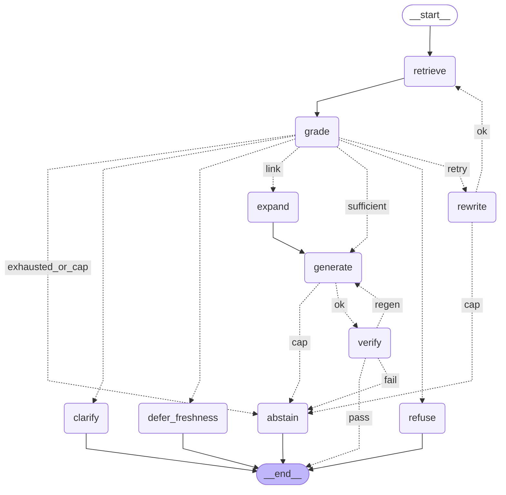

# Agent 그래프 구조도

> 이 파일은 `python -m src.agent.export` 가 LangGraph 그래프에서 자동으로 만들어요. 직접 고치지 마세요.
> 구조도(기획서 4장)와 노드·갈래가 1:1 이에요: `tests/test_agent.py` 가 같은지 확인해요.

## 노드 역할
모든 판단은 **검색 결과를 본 뒤** grade 가 한 번에 해요. 검색 전 판단(route)은 답할 수 있는 질문까지 거절해서 없앴어요 (결정 D34).

| 노드 | 하는 일 | 방법 |
|---|---|---|
| retrieve | `search(query, k, scope)` (하이브리드, 범위 강제). 첫 검색은 질문 그대로, 재검색은 rewrite 검색어로 | 검색 도구 |
| grade | 검색 결과를 보고 대응 행동(7가지)·인젝션 여부(`clean_query`)·근거 충분 여부·링크 보완 가능 여부·부족한 정보를 한 번에 판단 | AI 1회 |
| rewrite | 부족한 정보를 바탕으로 검색어 다시 쓰기 (인젝션이면 지시를 뺀 질문으로) | AI 1회 |
| expand | `get_parent`·`follow_ref` 로 링크를 따라 근거 보충 (2차, `agent.expand` 설정이 꺼져 있으면 분기 없음) | 검색 도구 |
| generate | 답변 JSON 작성 (재생성이면 verify 실패 이유를 같이 전달) | AI 1회 |
| verify | 인용이 검색 결과에 있는지, 숫자가 근거에 있는지 | **규칙만, AI 호출 없음** |
| refuse / clarify / defer_freshness | grade 판단에 따른 정형 응답 | AI 없음 |
| abstain | 근거 부족을 밝히고 답하지 않음 | AI 없음 |

## 분기와 종료 조건
| 분기 | 조건 |
|---|---|
| grade → refuse / clarify / defer_freshness | grade 가 검색 결과를 보고 해당 대응 행동으로 판단 |
| grade → generate | 근거 충분 (answer / answer_qualified / correct) |
| grade → expand → generate | 링크로 보완 가능 (2차, 설정 `agent.expand`) |
| grade → rewrite → retrieve | 부족 & 재검색 < 2 |
| grade → abstain | 부족 & 재검색 = 2 |
| verify → END | 통과 |
| verify → generate | 실패 & 재생성 < 1 (실패 이유를 같이 전달) |
| verify → abstain | 실패 & 재생성 = 1 |
| grade / rewrite / generate → abstain | AI 호출 7회 상한 도달 (grade 3 + rewrite 2 + generate 2 = 7) |
