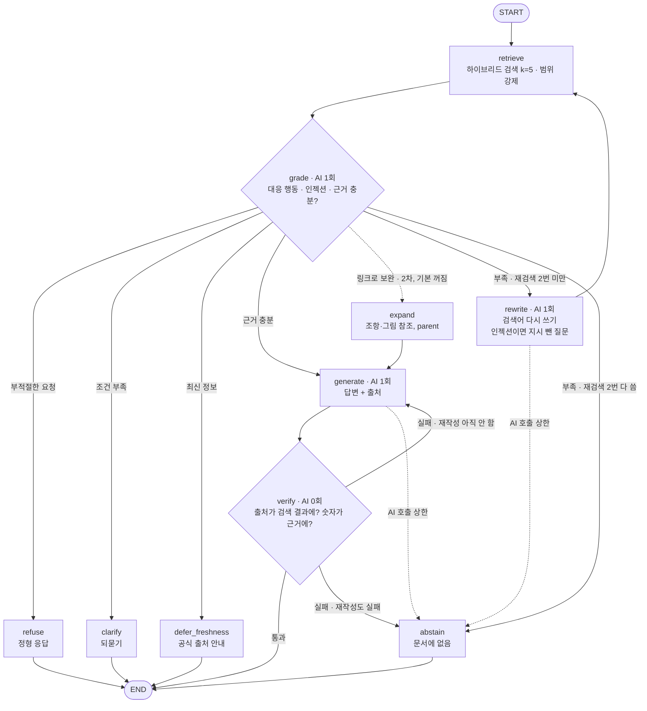

# Agent 구조도 (설명판)

> 사람이 읽기 위한 설명판이에요. 코드와 1:1로 맞는 기본 그림은 [`agent_graph.md`](agent_graph.md)(`python -m src.agent.export`로 자동 생성)이고, 이 문서는 그 그림에 분기 조건·AI 호출 수·바뀐 이유를 덧붙였어요.
> 코드: [`src/agent/graph.py`](../src/agent/graph.py) · 설계: [기획서](기획서.md) 4장 · 결정: D34·D35·D36 ([02 결정 기록](개발기록/02_결정_기록.md))
> **마지막 갱신**: 2026-10-22 · yellowgreenbean (그래프를 바꾸면 이 문서도 같이 고쳐요)

**모든 판단은 검색 결과를 본 뒤에 해요.** 검색 → `grade`가 한 번에 판단 → 부족하면 다시 검색 → 답변 → 규칙 검사. 기본 RAG와 같은 검색 도구·AI·프롬프트를 쓰고 흐름만 달라요.

## 1. 그래프

실선은 정상 흐름, 점선은 AI 호출 상한에 걸렸을 때와 2차 기능(`expand`)이에요.

## 2. 이전 구조와 차이

| | 이전 (v2까지) | 지금 (D34) |
|---|---|---|
| 흐름 | ~~route~~ → retrieve → grade → generate → verify | **retrieve → grade** → generate → verify |
| 거절·되묻기·보류 판단 | 검색 **전에** `route`가 정함 | 검색 결과를 본 `grade`가 정함 |
| 일반 질문의 AI 호출 | 3번 (route · grade · generate) | **2번** (기본 RAG와 같음) |
| 인젝션 | route가 찾고 그 질문으로 검색 | 첫 grade가 찾으면 끝까지 유지, 재검색·답변은 지시를 뺀 질문(`clean_query`)으로 |
| AI 호출 상한 | 8 | **7** |

`route`를 없앤 이유: 시험 40문항에서 문서를 찾아보면 답할 수 있는 질문까지 검색 전에 포기했어요 (과다 거절 0.32, RAG 0.03 → [F8](개발기록/05_실패사례_개선.md)).

## 3. 노드

| 노드 | 하는 일 | AI 호출 |
|---|---|---|
| retrieve | 첫 검색은 질문 그대로, 재검색은 rewrite가 만든 검색어로. 질문 세트마다 검색 범위(`doc_type`)를 강제해요 | 0 |
| grade | 검색 결과를 보고 대응 행동 7가지, 인젝션 여부와 `clean_query`, 근거 충분 여부(`sufficient`), 링크 보완 가능 여부(`link_hint`), 부족한 정보를 한 번에 판단. JSON이 깨지면 abstain으로 보고 재검색 | 1 |
| rewrite | 부족한 정보를 바탕으로 문서에 나올 법한 용어로 검색어를 다시 써요 | 1 |
| expand | 조항·그림 참조와 parent 청크로 근거 보충. 2차 목표라 기본 꺼짐(`agent.expand=false`) | 0 |
| generate | 답변과 출처 `(파일명 p.N)` 작성. 재작성이면 verify 실패 이유를 같이 넘겨요 | 1 |
| verify | 출처가 검색 결과에 있는지, 답변 속 숫자가 근거·질문에 있는지, 출처가 1개 이상인지 **규칙으로만** 검사 | 0 |
| refuse · clarify · defer_freshness · abstain | grade 판단 이유로 만든 짧은 정형 응답. 근거를 인용하지 않아요 | 0 |

## 4. 분기와 끝내는 조건

| 분기 | 조건 |
|---|---|
| grade → refuse / clarify / defer_freshness | grade가 그 대응 행동으로 판단 (재검색 없이 바로 끝) |
| grade → generate | answer / answer_qualified / correct 이고 근거 충분 |
| grade → rewrite → retrieve | 근거 부족(answer류인데 `sufficient=false` 또는 abstain) & 재검색 < 2 |
| grade → abstain | 근거 부족 & 재검색 = 2 |
| verify → generate | 검사 실패 & 재작성 < 1 |
| verify → abstain | 검사 실패 & 재작성 = 1 |
| grade / rewrite / generate → abstain | AI 호출 상한 도달 |

| 설정 (`configs/baseline.json` `agent`) | 값 |
|---|---|
| `max_retrieval_retries` (다시 검색) | 2 |
| `max_regenerate` (다시 답변) | 1 |
| `max_llm_calls` (문항당 AI 호출) | 7 = grade 3 + rewrite 2 + generate 2 |
| `expand` | false |

## 5. 지금 성능과 남은 문제 (시험 40문항, [04 R5](개발기록/04_실험_결과.md))

| 지표 | 기본 RAG | Agent |
|---|---|---|
| 답변 점수 (0~2) | 1.30 | **1.40** |
| 과다 거절률 | **0.03** | 0.12 |
| 질문당 AI 호출 | 2.0 | 2.05 |

- 남은 과다 거절은 grade 판단이 아니라 **verify의 숫자 검사 오탐**이에요.
  - 출처 파일명 안의 괄호(`15_유사해외통화선물(FX Margin Trading) 거래약관`) → 파일 번호를 숫자로 잡음 (F14 남은 경우, 인계 문서 결정할 것 9)
  - 질문 숫자로 계산한 값(예: 월 50만원 × 12 = 600만원)을 막음 (F16, 결정할 것 8)
- 표본이 40문항이라 방향만 보는 용도예요 (문항 1개 = 2.5%p).
