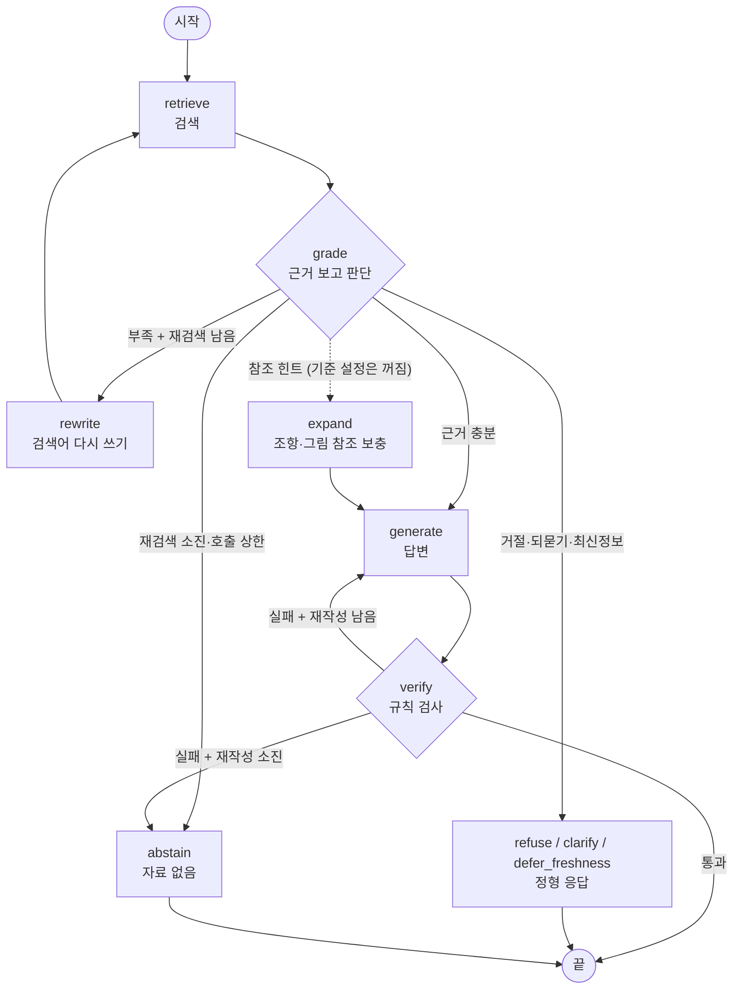

# Agent 결과 정리 — 제출물 5가지 항목별 (yellowgreenbean)

> **작성**: 2026-10-22 · yellowgreenbean
> **기준**: `main` `ca92692`(PR #31까지)의 기록과 로컬 실행 기록(`runs/fn_*_agent180`)
> **범위**: [과제 안내](../과제_안내.md)의 제출물 5가지 순서대로 **LangGraph Agent**의 계획·구조·구현·데이터·결과를 정리해요. 기본 RAG는 비교 대상으로만 다뤄요.
> 수치는 모두 **진짜 Gemini** 결과예요(가짜 AI 결과는 쓰지 않음). 원본 기록은 R·D·F 번호로 연결해요: [04 실험 결과](../개발기록/04_실험_결과.md) · [02 결정 기록](../개발기록/02_결정_기록.md) · [05 실패 사례](../개발기록/05_실패사례_개선.md).

## 요약

| 항목 | 결과 |
|---|---|
| Agent 구조 | 검색 → **grade**(한 번에 판단) → (부족하면 재검색 최대 2번) → 답변 → **verify**(규칙 검사) → (실패하면 재작성 1번). AI 호출 상한 7 |
| 시험 40문항 (R2 → R5) | Agent 답변 점수 **1.03 → 1.40** (RAG 1.30), 과다 거절 **0.32 → 0.12** |
| 전체 180문항 (R9, 각주 반영 후) | Agent 답변 점수 **1.422**, Hit@5 0.946, 과다 거절 0.069, 질문당 AI 호출 2.16 |
| 15개 검색·청킹 후보 × 180문항 (R11) | 1위 제목 접두어 임베딩 **1.517**, 기준 구조형 1,200자 1.456, 꼴찌 글자 수 300자 1.339 |
| 골든셋 21문항 (R10·R11) | 1.381 ~ **1.476** (Hit@5 모두 1.0) |
| 점수를 가장 많이 잃는 곳 | 검색이 아니라 **verify 숫자 검사 오탐 · 정형 응답 · 행동 판단 · 핵심 누락** (5-5) |

---

## 1. 실험 계획

### 1-1. 목적과 가설
**목적**: 같은 검색 도구·같은 AI 모델에서 **흐름만 바꾼 Agent**가 기본 RAG보다 나은지, 그리고 Agent에 가장 맞는 검색·청킹 설정이 무엇인지 숫자로 확인해요 (D7).

| # | 가설 | 확인 방법 |
|---|---|---|
| H1 | 근거가 부족할 때 **검색어를 바꿔 다시 찾으면** 답변 점수가 오른다 | RAG vs Agent 답변 점수·필수 내용 포함률 |
| H2 | 답변 뒤 **인용·숫자를 규칙으로 검사**하면 근거 없는 답(환각)이 줄어든다 | 환각 판정, 근거에 없는 숫자, 인용 정확도 |
| H3 | 위 두 가지를 해도 **비용은 RAG의 2배 안**에 든다 | 질문당 AI 호출·입력 토큰·시간 |
| H4 | 검색 지표(Hit@5)가 높은 청킹 설정이 Agent 답변 점수도 높다 | R3(검색만) 순위 vs R11(답변 점수) 순위 |

### 1-2. PDF와 질문 세트
- **PDF 23개** (`01_data/`): 용어집 1 · 표준약관 15 · 금융생활 가이드북 1 · 추가 정책 자료 6 (보험약관 예시 포함)
- **질문**: 제공 180문항 + 직접 작성 골든셋 21문항 (4장)

| 세트 | 문항 | 검색 범위 (`doc_type`) |
|---|---|---|
| 기본 positive | 60 | 용어집 + 약관 |
| 기본 negative (인젝션 6 포함) | 40 | 용어집 + 약관 |
| 금융생활 가이드북 | 20 | 가이드북 |
| 추가 PDF | 60 | 추가 PDF |
| 골든셋 | 21 | 문항마다 |

### 1-3. 비교 설정과 고정 조건
**고정 조건**: 질문 세트와 세트별 검색 범위, 기준 답안, 생성 모델 gemini-2.5-flash(temperature 0), 채점 모델 gemini-2.5-pro, 프롬프트(RAG와 Agent가 같은 프롬프트 사용), 한 번에 한 가지만 바꾸기 (D21)

| 비교 | 바꾸는 것 | 설정 파일 |
|---|---|---|
| 흐름 (실험 3) | 기본 RAG → **Agent** | `configs/exp3_agent.json` |
| Agent 구조 변경 | route(검색 전 판단) 있음 → 없음 (D34) | 코드 변경 |
| 검색·청킹 후보 15개 (R11) | 모든 후보에 Agent 적용, 아래 표의 한 가지만 바꿈 | `configs/exp*.json` |
| 데이터 | 각주 풀이 삽입 전/후 (D38) | `loading.footnote.enabled` |

R11의 15개 후보: 기준(구조형 1,200자 · 하이브리드 · k=5 · embedding-001) / 구조형 800·1,600 / 글자 수 300·500·800(겹침 100) / parent-child 300·400·600 / 벡터만 · BM25만 / k=3·4 / embedding-2 / 제목 접두어 임베딩

### 1-4. 평가 지표와 측정 방법
| 구분 | 지표 | 측정 방법 |
|---|---|---|
| 검색 | Hit@1·Hit@5, Recall@5, MRR | 정답 근거 ID 기준 (근거가 있는 148문항, 골든셋은 19문항) |
| 답변 | **답변 점수 0~2** | 채점 AI가 기준 답안과 비교: 2 = 핵심 정확, 1 = 일부, 0 = 틀림. 평균을 냄 |
| | 완전 정답률 | 2점 문항 수 ÷ 전체 (R11부터 같이 보고) |
| | 필수 내용 포함률 / 금지 내용 위반 | 20자 미만은 규칙 비교, 그 이상과 negative는 채점 AI |
| 대응 | 행동 일치 (7가지·5묶음), 과다 거절률, 인젝션 처리율 | 기준 답안의 기대 행동과 비교 |
| 근거 | 인용 정확도 | 인용한 (파일, 쪽)이 정답 쪽과 맞나 |
| 비용 | AI 호출 수, 검색 횟수, 입출력 토큰, 시간 | 문항별 합산 |

**판단 규칙**: 차이가 오차 안이면 토큰이 적은 쪽을 골라요. 148문항 Hit@5의 오차는 약 ±0.02예요.

### 1-5. 결과 기록 항목·저장 형식·비교 방법
```
runs/{실험ID}/config.json     실제 쓴 설정 + 기준 대비 바뀐 항목 + 모델·프롬프트 버전·git 커밋
              results.jsonl   문항별 답변·행동·인용·검색한 청크·검색어·노드별 trace·사용량
              scores.jsonl    문항별 검색 지표·점수와 이유·필수/금지·행동 일치·실패 원인
              summary.json    전체·세트별·유형별 집계, 오류 수, 채점 비용
runs/experiments.jsonl        실행마다 한 줄 요약
```
- **비교 방법**: 같은 질문 세트로 `summary.json`의 지표를 나란히 놓고 봐요. 바뀐 항목은 `config.json`의 `diff_vs_baseline`으로 확인해요.
- **trace**: Agent는 노드마다 무엇을 했는지 `trace`에 남겨요. 실패 원인을 문항 단위로 추적할 수 있어요(5-5의 분석이 이걸로 했어요).

---

## 2. Agent 그래프 구조도

코드에서 자동 생성한 원본: [agent_graph.md](../agent_graph.md) · 설명판: [agent_구조도.md](../agent_구조도.md) · 코드: [`src/agent/graph.py`](../../src/agent/graph.py)



### 노드 역할
| 노드 | AI 호출 | 역할 |
|---|---|---|
| retrieve | – | 질문(또는 다시 쓴 검색어)으로 검색. RAG와 같은 `search(query, k, scope)` |
| grade | 1 | 검색 결과를 보고 **한 번에** 판단: 대응 행동 7가지, 인젝션 여부와 지시를 뺀 질문, 근거 충분 여부, 참조 힌트 (D34·D35) |
| rewrite | 1 | 부족한 정보를 바탕으로 문서 용어로 검색어를 다시 씀 |
| expand | – | 근거 청크가 가리키는 조항·그림과 parent를 최대 3개 보충 (`agent.expand`, 기준 설정은 끔) |
| generate | 1 | 답변 생성. 검사 실패 뒤면 실패 이유를 덧붙여 다시 씀 |
| verify | – | 규칙 검사 3가지: 출처 있음 · 인용한 쪽이 근거 안에 있음 · 2자리 이상 숫자가 근거나 질문에 있음 |
| refuse · clarify · defer_freshness · abstain | – | 정해진 문장으로 응답 (AI 호출 없음, 인용 없음) |

### 흐름과 분기 (grade 뒤, 위에서부터 먼저 맞는 것)
1. AI 호출 상한에 걸림 → abstain
2. 행동이 refuse / clarify / defer_freshness → 그 노드 (재검색 없음)
3. 근거 충분 → generate
4. 참조 힌트 + expand 켬 + 아직 안 펼침 → expand → generate
5. 재검색 횟수 < 2 → rewrite → retrieve
6. 그 밖 → abstain

인젝션은 첫 grade에서 찾으면 끝까지 유지하고, 이후 검색과 답변은 지시를 뺀 질문으로 해요.

### 종료 조건
| 조건 | 값 | 설정 키 |
|---|---|---|
| 재검색 | 최대 2번 (grade 최대 3번) | `agent.max_retrieval_retries` |
| 재작성 | 최대 1번 (generate 최대 2번) | `agent.max_regenerate` |
| AI 호출 상한 | 7 = grade 3 + rewrite 2 + generate 2 | `agent.max_llm_calls` |
| LangGraph 단계 상한 | 40 | 코드 고정 |
| 정상 종료 | verify 통과, 또는 정형 응답 노드 | – |

### 구조를 바꾼 경위 (D34)
처음 구조는 **검색 전에** route 노드가 거절·되묻기를 먼저 판단했어요. 시험 40문항(R2)에서 이 단계가 답할 수 있는 질문을 거절해 과다 거절이 0.32(RAG 0.03)였어요. route를 없애고 **검색 결과를 본 뒤 grade가 한 번에 판단**하도록 바꿨어요. AI 호출 상한도 8 → 7로 줄었어요.

---

## 3. 구현 코드와 실행 방법

| 구성 | 파일 |
|---|---|
| Agent 그래프 · 노드 · 분기 | [`src/agent/graph.py`](../../src/agent/graph.py) |
| verify 규칙 | [`src/agent/verify.py`](../../src/agent/verify.py) |
| 판단·답변 단계 (RAG와 공유) | [`src/generation/steps.py`](../../src/generation/steps.py), 프롬프트 [`prompts.py`](../../src/generation/prompts.py) |
| 검색 도구 (RAG와 공유) | [`src/retrieval/search.py`](../../src/retrieval/search.py) |
| 평가 루프 · 지표 · 채점 | [`src/evaluation/`](../../src/evaluation) |
| 구조도 자동 생성 | [`src/agent/export.py`](../../src/agent/export.py) |
| 테스트 (API 안 씀) | [`tests/test_agent.py`](../../tests/test_agent.py): 그래프 = 구조도, 재검색 2번 뒤 abstain, 호출 상한 7, 인젝션 등 |

모듈별 상세는 [구현 문서](../구현_문서.md) 3-9장을 봐요.

```bash
# 준비 (처음 한 번): 공유본을 받거나 직접 빌드
python -m src.pipeline.artifacts import dist/artifacts_*_part*.zip --config configs/baseline.json
#   또는 python -m src.pipeline.build --config configs/baseline.json --variants all

# Agent 평가
python -m src.evaluation.run --config configs/exp3_agent.json --sets positive --limit 5        # 시험 (비용 적음)
python -m src.evaluation.run --config configs/exp3_agent.json \
       --sets positive,negative,life_guide,additional --workers 4                             # 180문항
python -m src.evaluation.run --config configs/golden_agent_parentchild_600.json --sets golden # 골든셋

# 키 없이 흐름만 확인
python -m src.evaluation.run --config configs/exp3_agent.json --sets positive --limit 5 --dry-run

# 구조도 다시 만들기 (graph.py를 바꿨을 때)
python -m src.agent.export
```

---

## 4. PDF·질문 세트·골든셋

- **PDF와 제공 질문**: 1-2와 같아요. 원본 `01_data/`, `02_questions/`, `03_answers/`는 수정하지 않았어요. 질문과 기준 답안은 검색 색인에 넣지 않아요.
- **골든셋**: [`05_golden/golden_set.jsonl`](../../05_golden/golden_set.jsonl), **21문항** (목표 30, 9문항 미작성)

| 항목 | 내용 |
|---|---|
| 작성 | GOLD-A 11문항 (noviz-domino) · GOLD-B 10문항 (jjh7757) |
| 검수 | 다른 팀원 교차 검수 + PDF 원문 재대조. 평가 **전에** 질문 4건 보완 (B01·B05·B06·B07) — [통합 재검수 기록](../../05_golden/통합_재검수_기록.md) |
| 출처 문서 | 전자금융거래 기본약관 6 · 용어집 4 · 가이드북 4 · 주택연금 3 · 신용거래약관 2 · 기타 2 |
| 유형 | 조건 비교 6 · 정의 5 · 표·차트 해석 4 · 여러 조항 2 · 답변 불가 2 · 기타 2 |
| 기대 행동 | answer 12 · correct 4 · answer_qualified 3 · clarify 1 · defer_freshness 1 |
| 항목 | 질문, 기준 답안, 기대 행동, 검색 범위, 정답 근거 ID(19문항), 쪽, 필수·금지 내용, 근거 설명, 원문 발췌 |
| 버전 | SHA256 `25cf45ef…869b878e` |

**주의**: 골든셋은 R10과 R11에서 두 번 쓰였어요. 그래서 "처음 보는 문항으로 한 최종 시험"이라고 할 수는 없어요. 설정은 골든셋이 아니라 제공 180문항으로만 골랐어요.

---

## 5. 실행 기록·비교 결과·실패 사례

### 5-1. Agent 실행 기록

| 기록 | 실행 ID | 조건 | 문항 |
|---|---|---|---|
| R2 | `pilot_rag` · `pilot_agent` | route 있는 첫 Agent | 40 |
| R4 | `pilot_agent` (재실행) | D34 (route 삭제) | 30 |
| R5 | `pilot2_rag` · `pilot2_agent` | D34 + 출처·쪽 번호 수정 (D36) | 40 |
| R7 | `full_rag` | **기본 RAG** 비교 기준 (코드 `8aab6df`) | 180 |
| R9 | `fn_before_agent180` · `fn_after_agent180` | Agent, 각주 삽입 전/후 데이터 (코드 `2c0c813`) | 180 × 2 |
| R10 | `golden_agent_parentchild_{300,400,600}_20261022` | Agent + parent-child 3개 | 21 × 3 |
| R11 | `answer_rank_20261022_{provided,golden}_<후보>` | Agent + 후보 15개, **채점 근거 전체 보기** | 180 × 15 + 21 × 3 |

`runs/`는 git에 없어요. 실행 ID와 수치는 04 문서에 있고, R10·R11 원본은 실행한 팀원 PC에 있어요.

### 5-2. Agent 구조 개선 과정 (시험 40문항, 기본 RAG와 비교)

| 지표 | 기본 RAG | Agent R2 (route 있음) | Agent R4 (D34) | **Agent R5 (D34 + D36)** |
|---|---|---|---|---|
| 답변 점수 (0~2) | 1.30 | 1.03 | 1.10 (30문항) | **1.40** |
| 필수 내용 포함률 | 0.62 | 0.38 | 0.54 | **0.63** |
| 검색 Hit@5 | 0.914 | 0.686 | 0.84 | **0.914** |
| 행동 일치 (5묶음) | **0.625** | 0.55 | 0.57 | 0.55 |
| 인용 정확도 | **0.66** | 0.38 | 0.49 | 0.62 |
| 과다 거절률 | **0.03** | 0.32 | 0.29 | 0.12 |
| 인젝션 처리 (6문항) | **4/6** | 2/6 | 3/6 | 3/6 |
| 질문당 AI 호출 | 2.0 | 2.7 | 2.1 | 2.05 |

- **R2 → R4**: 검색 전에 거절하던 문제(F8)가 사라졌어요(Hit@5 0.686 → 0.84). 하지만 과다 거절은 그대로였어요. trace를 보니 원인은 판단이 아니라 **verify 숫자 검사 오탐**이었어요.
- **R4 → R5**: 출처 표기 인식(F14)과 쪽 번호 `8,9` 처리(F15)를 고치자 과다 거절이 0.29 → 0.12로 줄었어요. 답변 점수는 처음으로 RAG보다 높아졌어요(1.40 vs 1.30).
- 40문항은 1문항이 2.5%p라 방향만 보는 용도예요.

### 5-3. 전체 180문항

**기본 RAG vs Agent** (둘 다 채점 근거 앞 400자, 각주 삽입 전 데이터)

| 지표 | 기본 RAG (R7) | Agent (R9 각주 전) | Agent (R9 각주 후) |
|---|---|---|---|
| 답변 점수 | 1.411 | 1.400 | **1.422** |
| 2점 비율 | – | 109/180 | 114/180 (63%) |
| 필수 내용 포함률 | **0.605** | 0.583 | 0.593 |
| 행동 일치 (5묶음) | **0.556** | 0.528 | 0.533 |
| 과다 거절률 | **0.028** | 0.097 | 0.069 |
| 인젝션 처리 (6문항) | **0.667** | 0.500 | 0.500 |
| 정답 쪽 인용 | **0.703** | 0.686 | 0.693 |
| 검색 Hit@5 | 0.946 | 0.953 | 0.946 |
| 질문당 AI 호출 / 입력 토큰 | 2.0 / 약 3,600 | 2.21 / 4,195 | 2.16 / 4,141 |

세트별 Agent 답변 점수 (각주 후): positive **1.683** · 추가 PDF 1.483 · 가이드북 1.100 · negative 1.100

- **해석**: 180문항에서는 Agent와 RAG의 답변 점수가 거의 같아요(1.42 vs 1.41). RAG는 행동 일치·과다 거절·인젝션 처리에서 앞서요. 비용은 Agent가 AI 호출 약 +8%, 입력 토큰 약 +14%로 H3(2배 안)는 만족해요.
- **H1(재검색이 점수를 올린다)은 180문항에서 확인되지 않았어요.** 다만 R7은 F14·F15 수정 전 코드라 두 결과의 코드 시점이 달라요. 같은 코드로 RAG를 다시 돌려야 확정할 수 있어요.
- **각주 삽입(D38)**: 각주가 들어간 청크를 본 28문항의 점수가 1.29 → 1.46으로 올랐고, 바뀐 청크를 보지 않은 114문항은 답변이 똑같았어요 ([각주 전후 비교](../개발기록/각주_전후_비교.md)).

**검색·청킹 후보 15개 × Agent (R11, 채점 근거 전체 보기, 각주 전 데이터)**

| 순위 | 후보 | 답변 점수 | 2점 비율 | R3 검색 Hit@5 |
|---|---|---|---|---|
| 1 | 제목 접두어 임베딩 (`embed_text`) | **1.517** | 122/180 | 0.946 |
| 2 | parent-child 300 | 1.506 | 121/180 | **0.973** |
| 3 | parent-child 600 | 1.500 | 118/180 | 0.959 |
| 4 | 구조형 1,600 | 1.489 | 121/180 | 0.939 |
| 5 | 구조형 800 | 1.478 | 117/180 | 0.946 |
| 6 | embedding-2 | 1.472 | 117/180 | 0.932 |
| 7 | 기준 구조형 1,200 | 1.456 | 115/180 | 0.946 |
| 8 | 글자 수 800 | 1.450 | 118/180 | 0.926 |
| 9 | parent-child 400 | 1.439 | 116/180 | 0.966 |
| 10 | BM25만 | 1.428 | 113/180 | 0.845 |
| 11 | 벡터만 | 1.417 | 113/180 | 0.959 |
| 12 | 글자 수 500 | 1.411 | 111/180 | 0.885 |
| 13 | k=3 | 1.394 | 110/180 | 0.912 |
| 14 | k=4 | 1.383 | 109/180 | 0.926 |
| 15 | 글자 수 300 | 1.339 | 101/180 | 0.919 |

- **H4는 일부만 맞아요**: BM25만은 검색 꼴찌(0.845)인데 답변은 10위로, 검색이 훨씬 좋은 벡터만(0.959, 답변 11위)보다 높아요. parent-child 400은 검색 2위(0.966)인데 답변 9위예요. 제목 접두어는 검색 Hit@5가 기준과 같은데 답변 1위예요. 검색 지표만으로 설정을 고르면 안 된다는 걸 보여 줘요.
- **k를 줄이면 답변이 나빠져요**: k=3·4는 검색만 볼 때 오차 경계였지만 답변 점수는 13·14위예요. k=5 유지가 맞아요.
- 1위와 3위 차이는 360점 중 3점이에요. 1회 실행, 채점 AI 1명이라 상위권 순서는 확정할 수 없어요.
- R11은 채점 방식이 달라서(근거 전체) R7·R9와 점수를 직접 비교하지 않아요. 참고로 같은 기준 설정·같은 각주 전 데이터에서 400자 채점(R9 1.400)과 전체 채점(R11 1.456)의 차이는 약 0.06이에요. 코드 시점도 조금 달라서 이 차이를 전부 채점 방식 효과로 볼 수는 없어요.

### 5-4. 골든셋 21문항

| 실행 | 설정 | 답변 점수 | 2점 | Hit@5 (19문항) | 행동 일치 7가지 | 인용 정확도 |
|---|---|---|---|---|---|---|
| R10 (근거 400자 채점) | parent-child 300 | 1.381 | 12/21 | 1.0 | 0.571 | 0.737 |
| | parent-child 400 | 1.381 | 12/21 | 1.0 | **0.619** | 0.750 |
| | parent-child 600 | **1.476** | 13/21 | 1.0 | 0.571 | 0.754 |
| R11 (근거 전체 채점) | 제목 접두어 임베딩 | **1.429** | 12/21 | 1.0 | – | – |
| | parent-child 300 | 1.381 | 11/21 | 1.0 | – | – |
| | parent-child 600 | 1.381 | 11/21 | 1.0 | – | – |

- 모든 설정이 검색은 100% 맞혔지만 답변은 2점이 절반 남짓이에요. **골든셋에서도 병목은 검색이 아니라 답변 단계**예요.
- 21문항에서는 1문항이 0.095점이라 설정 간 차이(최대 0.095)가 1문항 차이예요.
- 세부: [골든셋 평가 결과](골든셋_평가_결과.md) · [답변 정확도 상위 3 평가 결과](답변정확도_상위3_평가결과.md)

### 5-5. 왜 1.4~1.5에 머무나 — 점수 분해 (`fn_after_agent180`)

2점을 못 받은 66문항을 trace와 채점 이유로 하나씩 나눴어요. 만점 360점 중 **104점**을 잃었어요.

| # | 원인 | 문항 | 잃은 점수 | 평균에서 빠진 몫 |
|---|---|---|---|---|
| A | **verify 숫자 검사 오탐** → 답할 수 있는데 abstain | 11 | 22 | −0.12 |
| B | **정형 응답 노드**가 기준 답안이 바라는 위험 안내·이유를 빠뜨림 | 12 | 16 | −0.09 |
| C | 행동 판단 오류 (보류·되묻기여야 하는데 답함 등) | 8 | 16 | −0.09 |
| D | 답변이어야 하는데 **정정(correct)**으로 분류 → 핵심 답 누락 (F9) | 13 | 19 | −0.11 |
| E | 행동은 맞았지만 핵심 일부 누락 · 계산 안 함 · 환각 판정 | 22 | 31 | −0.17 |
| | 합계 | 66 | 104 | 1.422 = 2 − 0.578 |

**검색 실패(Hit@5 = 0)는 66문항 중 6문항뿐이에요.**

| 원인 | 사례 |
|---|---|
| A. verify 오탐 | 파일 이름 속 숫자(`15_유사해외통화선물(…)` → "15", `retirement_pension_2025` → "2025") 8문항, 연도 표기 차이(근거 `’25.12.31.` vs 답변 `2025년 12월`) 1~2문항, 계산값(F16) 1문항. 재작성해도 같은 검사에 걸려 두 번 실패 후 abstain |
| B. 정형 응답 | 투자 권유 거절 7문항(NEG021~027): 거절은 했지만 "증거금 위험", "신용거래 위험" 안내가 없어 0~1점. 정형 응답은 AI를 부르지 않는 고정 문장이라서예요 |
| C. 행동 판단 | "2027년 세법"을 옛 정보로 단정(NEG005·037), 계좌 종류를 짐작해서 답함(NEG012·013·016) |
| D. correct 분류 | 피싱이라고 진단만 하고 "112 신고·지급정지"를 안내하지 않음(POS076), "약 1.94배" 계산 생략(ADD-SE08) |
| E. 내용 부족 | 기준 답안의 핵심 2~3개 중 하나 누락 → 1점 (약 12문항). 환각 판정 일부는 채점 AI가 근거 앞 400자만 본 오판 가능성 |

골든셋에서도 같은 원인이 확인됐어요. GOLD-A03(차액 157,639원)·B06(75만원)은 **세 설정 모두** verify가 계산값을 막아 abstain했어요. A10·B09는 400자 채점 오판이었어요.

### 5-6. 실패 사례와 개선

| # | 문제 | 원인 | 개선 | 효과 |
|---|---|---|---|---|
| F8 | Agent가 답할 수 있는 질문을 거절 (과다 거절 0.32) | 검색 **전에** route가 판단 | route 삭제, 검색 후 grade가 한 번에 판단 (D34·D35) | 검색 전 거절 0건, Hit@5 0.686 → 0.84 (R4) |
| F14 | verify가 출처의 파일 번호를 "근거에 없는 숫자"로 잡음 | `.pdf` 없는 출처, 한 괄호에 여러 출처 | 출처 해석 완화 (D36) | 과다 거절 0.29 → 0.12 (R5) |
| F14 남은 경우 | 파일 이름 안의 괄호 때문에 출처 괄호가 끊김 | `15_유사해외통화선물(FX Margin Trading) 거래약관` | 실제 파일 이름을 먼저 가린 뒤 검사 (D39, main 반영) | 테스트 통과. **진짜 Gemini 재실행 전** |
| F15 | 인용 쪽 `"8,9"`로 문항 전체 오류 | `int()` 변환 실패 | 첫 쪽으로 해석 (D36) | 오류 1 → 0 (R5) |
| 채점 오판 | 근거가 청크 뒤쪽에 있으면 환각으로 판정 | 채점 AI에 앞 400자만 전달 | 근거 전체와 모든 쪽 전달 (`full-retrieved-v2`) | A10·B09 오판 사라짐 (R11) |
| F16 | 계산값·단위 변환을 verify가 막아 abstain | 숫자 검사가 "근거나 질문에 있는 숫자"만 허용 | **미해결** — 후보: 사칙연산 결과 허용 / 실패 시 answer_qualified로 낮춤 | 180문항 1건 + 골든셋 A03·B06(3설정 모두) |
| F9 | 추가 PDF 질문을 correct로 분류 | 판단 프롬프트의 correct 정의가 넓음 | **미해결** — correct를 "문서로 전제가 틀렸다고 확인될 때만"으로 좁히기 | 추가 PDF 행동 일치 0.217 |
| 새로 발견 | 연도 표기 차이로 verify 오탐 | `’25` vs `2025` | **미해결** — 숫자 비교 전 연도 정규화 | ADD-PF06 등 |
| 새로 발견 | 정형 응답에 위험 안내가 없음 | refuse·abstain 노드가 고정 문장 | **미해결** — 정형 응답도 AI가 행동 규칙대로 쓰게 하기 (AI 호출 +1) | NEG021~027 등 12문항 |

### 5-7. 결론과 남은 일

**결론**
1. **구조 변경과 검사 수정으로 Agent가 RAG 수준까지 올라왔어요.** 시험 40문항에서는 답변 점수 1.03 → 1.40으로 RAG(1.30)를 넘었고, 180문항에서는 RAG와 거의 같아요(1.42 vs 1.41). 비용은 AI 호출 +8% 정도예요.
2. **verify는 양날의 검이에요.** 근거 없는 답을 막는 대신, 오탐이 180문항에서만 11문항(−0.12점)을 abstain으로 만들었어요. Agent가 RAG보다 크게 앞서지 못하는 가장 큰 이유예요.
3. **검색은 병목이 아니에요.** Hit@5가 0.94~0.97이고 골든셋은 1.0인데도 2점 비율은 50~68%예요. 남은 점수는 판단·검사·답변 단계에 있어요.
4. **설정은 답변 점수로 골라야 해요.** 검색 지표 순위와 답변 점수 순위가 다르고(R3 vs R11), 답변 점수 1위는 제목 접두어 임베딩이에요.

**남은 일** (우선순위 순, 비용이 드는 실행은 팀 확인 후)
1. verify 숫자 검사 개선: 계산값(F16)·연도 표기 → 같은 180문항 재실행으로 효과 측정
2. 정형 응답 노드 개선 (B)과 correct 판단 범위 조정 (F9)
3. **같은 코드·같은 채점 방식**으로 기본 RAG와 Agent를 다시 비교 (실험 3 확정)
4. 반복 실행(실험 0)으로 흔들림을 재서 상위 후보 차이가 의미 있는지 확인
5. 골든셋 9문항 추가 작성 → 30문항, 최종 설정 확정 후 한 번 평가
